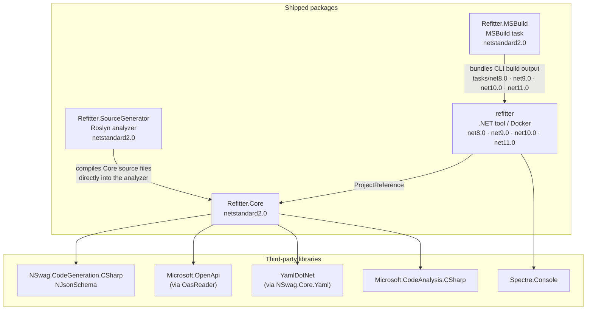
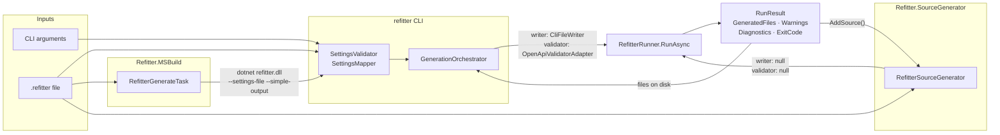

# Architecture Overview

This section of the documentation describes how Refitter works internally: how an OpenAPI specification becomes Refit interfaces and contracts, how that differs between the three distribution forms (CLI tool, MSBuild task and C# Source Generator), and how the project is tested to avoid regressions.

| Page | What it covers |
|---|---|
| [Architecture Overview](architecture.md) | Projects, packages, dependencies and the shared generation entry point |
| [Code Generation Pipeline](core-pipeline.md) | `Refitter.Core`: document loading, filtering, NSwag contracts, interface generation, output planning |
| [CLI Tool Internals](cli-internals.md) | Argument parsing, settings validation, reporters, file writing and exit codes |
| [MSBuild Task Internals](msbuild-internals.md) | How `Refitter.MSBuild` runs the bundled CLI during a build |
| [Source Generator Internals](source-generator-internals.md) | The incremental generator, nested Refit / System.Text.Json generators and diagnostics |
| [Testing and Regression Prevention](testing.md) | Unit, scenario, compilation, smoke, package and nightly production tests |

## Projects and packages

Refitter is a single solution (`src/Refitter.slnx`) with four shipping projects and two test projects.

| Project | Target framework | Ships as | Role |
|---|---|---|---|
| `Refitter.Core` | `netstandard2.0` | `Refitter.Core` NuGet package | All code generation logic, built on NSwag |
| `Refitter` | `net8.0;net9.0;net10.0;net11.0` | `refitter` .NET tool and Docker image | Command line interface |
| `Refitter.MSBuild` | `netstandard2.0` | `Refitter.MSBuild` NuGet package | MSBuild task that runs the bundled CLI before `CoreCompile` |
| `Refitter.SourceGenerator` | `netstandard2.0` | `Refitter.SourceGenerator` NuGet package (analyzer) | Roslyn incremental source generator |
| `Refitter.Tests` | `net11.0` | – | Unit, scenario and compilation tests |
| `Refitter.SourceGenerator.Tests` | `net8.0;net10.0;net11.0` | – | Source generator integration tests |

Two details in this picture are easy to miss:

- **`Refitter.MSBuild` does not reference `Refitter.Core`.** It contains a small MSBuild task and the complete build output of the CLI for each supported runtime. At build time it starts the CLI as a `dotnet` child process. See [MSBuild Task Internals](msbuild-internals.md).
- **`Refitter.SourceGenerator` does not reference the `Refitter.Core` package either.** Analyzers cannot reliably load arbitrary package dependencies, so the generator project compiles the `Refitter.Core` source files (`<Compile Include="../Refitter.Core/..." />`) into its own assembly and ships its third-party dependencies inside the analyzer folder. See [Source Generator Internals](source-generator-internals.md).

## One shared entry point

All three distribution forms end up in the same method: [`RefitterRunner.RunAsync`](https://github.com/christianhelle/refitter/blob/main/src/Refitter.Core/RefitterRunner.cs). What differs is how settings arrive, whether files are written, and whether the OpenAPI specification is validated.

`RefitterRunner.RunAsync` takes a `RefitGeneratorSettings` object and two optional collaborators:

- an `IFileWriter`, which the CLI provides (`CliFileWriter`) and the source generator leaves out, so nothing is written to disk from inside the compiler;
- an `IValidator`, which the CLI provides unless `--skip-validation` is set, and the source generator leaves out.

It always returns a `RunResult` and never throws. Exceptions are captured as error diagnostics, and `ExitCode` is set to the exception's `HResult`.

## Comparing the three distribution forms

| | CLI tool | MSBuild task | Source Generator |
|---|---|---|---|
| Runs | When you run `refitter` | Every build, before `CoreCompile` | Inside the C# compiler, on every compilation (including IDE design-time builds) |
| Settings | CLI arguments or `--settings-file` | Every `*.refitter` file under the project folder (optionally filtered by `RefitterIncludePatterns`) | Every `*.refitter` file in `AdditionalFiles` |
| Process model | In-process | Separate `dotnet refitter.dll` process per `.refitter` file | In the compiler process |
| Output | Files on disk | Files on disk, added to `Compile` items | In-memory syntax trees via `AddSource()` |
| `outputFolder` / `outputFilename` | Honoured | Honoured | Only used to derive hint names |
| OpenAPI validation | Yes, unless `--skip-validation` | Yes, unless `RefitterSkipValidation` is `true` | No |
| Refit source generator | Runs normally in the consuming project's build | Runs normally on the generated files | Disabled in the regular pass and re-run by Refitter over its own output, unless the project sets `DisableRefitSourceGenerator=true` itself (then Refit generation stays off) |
| Incremental | No | No, regenerates on every build | Roslyn incremental pipeline |
| Reports problems as | Console output and exit code | MSBuild errors and messages | `REFITTER000`–`REFITTER008` compiler diagnostics |
| Telemetry | Analytics in the CLI process | CLI process, tagged `msbuild` | A post-build MSBuild task, tagged `sourcegenerator` |

## Library responsibilities

Refitter does not parse OpenAPI documents or generate DTOs on its own. It combines several libraries:

| Library | Used for |
|---|---|
| [NSwag](https://github.com/RicoSuter/NSwag) (`NSwag.Core.Yaml`, `NSwag.CodeGeneration.CSharp`) | The `OpenApiDocument` model, `$ref` resolution, and generation of the contract (DTO) types. Refitter subclasses `CSharpClientGenerator` but turns off NSwag's own client generation |
| [NJsonSchema](https://github.com/RicoSuter/NJsonSchema) | JSON schema model, type resolution and the Liquid templates for classes, records and enums |
| [Microsoft.OpenApi](https://github.com/microsoft/OpenAPI.NET) via [OasReader](https://github.com/christianhelle/oasreader) | OpenAPI validation, statistics, and reading specifications whose external references must be merged into one document |
| [YamlDotNet](https://github.com/aaubry/YamlDotNet) (via `NSwag.Core.Yaml`) | Converting YAML specifications to JSON before NSwag parses them |
| [Roslyn](https://github.com/dotnet/roslyn) (`Microsoft.CodeAnalysis.CSharp`) | Rewriting generated contracts and building the `JsonSerializerContext`, and in the source generator, running the nested Refit and System.Text.Json generators |
| [Spectre.Console](https://spectreconsole.net/) | CLI argument parsing and rich console output |

The Refit interfaces themselves are not produced by NSwag. Refitter writes them with its own `InterfaceGenerator`, using NSwag's operation and parameter models to resolve types. See [Code Generation Pipeline](core-pipeline.md).
