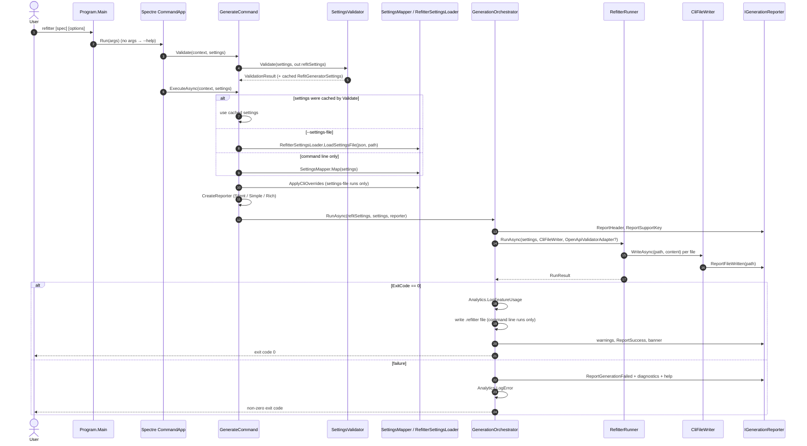
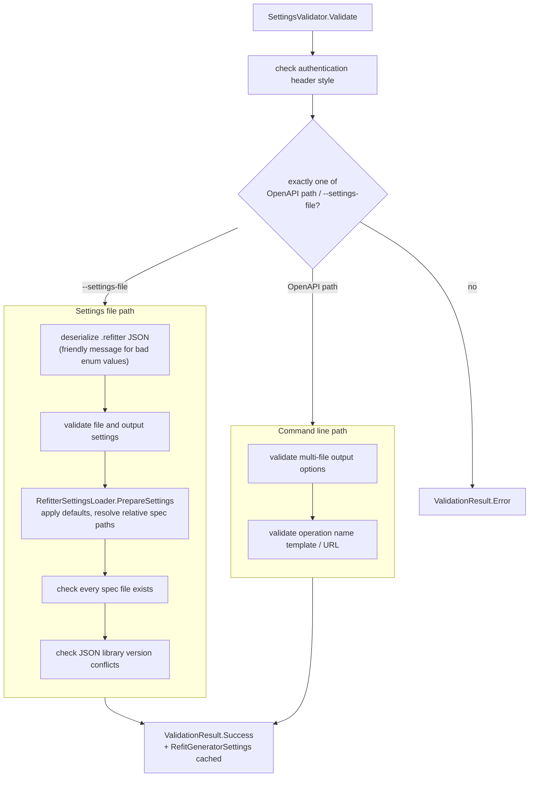
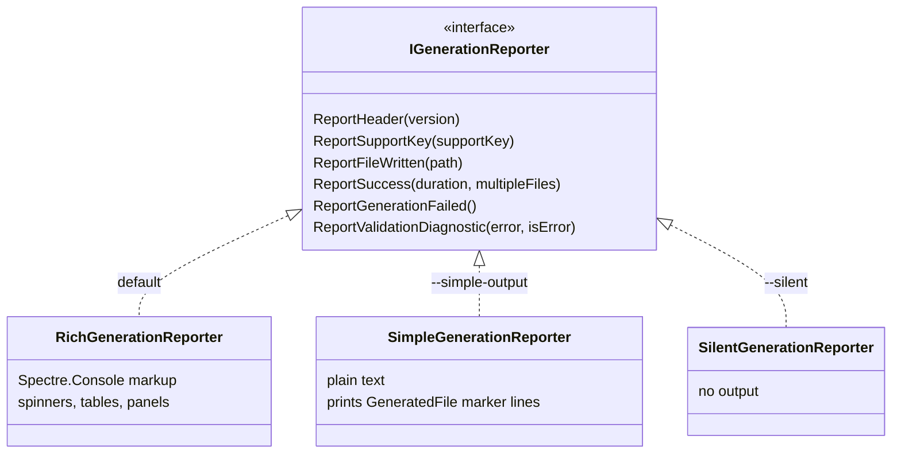
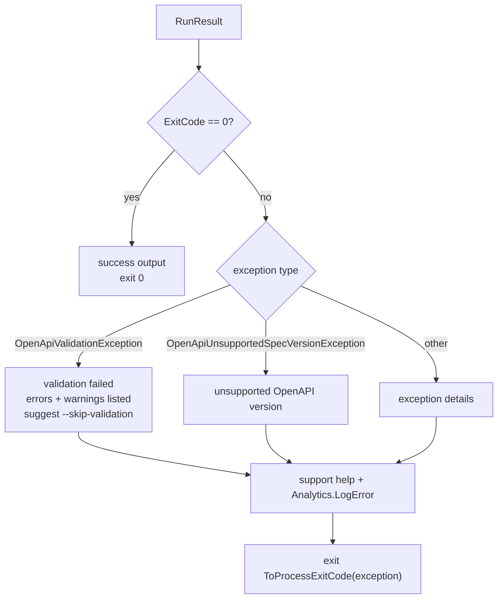

# CLI Tool Internals

The `refitter` .NET tool ([`src/Refitter`](https://github.com/christianhelle/refitter/tree/main/src/Refitter)) is a thin host around [`RefitterRunner`](core-pipeline.md#refitterrunner). Its job is to turn command line arguments or a `.refitter` file into `RefitGeneratorSettings`, validate them, run the generation, write files, and report what happened. It is also the engine behind [`Refitter.MSBuild`](msbuild-internals.md), which runs it as a child process.

The CLI targets `net8.0`, `net9.0` and `net10.0` and is published as a .NET tool and as a Docker image.

## End-to-end flow

## Parsing arguments

[`Program.Main`](https://github.com/christianhelle/refitter/blob/main/src/Refitter/Program.cs) creates a [Spectre.Console.Cli](https://spectreconsole.net/cli/) `CommandApp<GenerateCommand>`. Every command line option is a property with a `[CommandOption]` attribute on [`Settings`](https://github.com/christianhelle/refitter/blob/main/src/Refitter/Settings.cs). Spectre calls `GenerateCommand.Validate` first and `ExecuteAsync` only if validation succeeds.

## Validating settings

[`SettingsValidator`](https://github.com/christianhelle/refitter/blob/main/src/Refitter/SettingsValidator.cs) has two paths:

The settings produced during validation are cached on the command so `ExecuteAsync` doesn't parse the file twice.

## Building RefitGeneratorSettings

There are two sources of settings:

- **A `.refitter` file.** [`RefitterSettingsLoader`](https://github.com/christianhelle/refitter/blob/main/src/Refitter.Core/Settings/RefitterSettingsLoader.cs) (in `Refitter.Core`, shared with the source generator) deserializes the JSON and applies defaults. A positional OpenAPI path can't be combined with `--settings-file`: validation rejects it, so change the file instead: `openApiPath`, or `openApiPaths` if the file lists several specifications (setting both fails validation). For `--json-library-version`, validation rejects a run where both the CLI and the file set a value other than `8.0`. Otherwise [`SettingsMapper.ApplyCliOverrides`](https://github.com/christianhelle/refitter/blob/main/src/Refitter/SettingsMapper.cs) applies the CLI value when the file's value is `8.0` (whether set explicitly or by default), and keeps the file's value when only the file sets something else.
- **Command line options only.** `SettingsMapper.Map` uses [`ConventionMapper`](https://github.com/christianhelle/refitter/blob/main/src/Refitter/ConventionMapper.cs), which copies every public property that has the same name and type on both CLI `Settings` and `RefitGeneratorSettings` by reflection. Options whose meaning is inverted or combined are mapped explicitly afterwards, for example `GenerateContracts = !InterfaceOnly`, `GenerateClients = !ContractOnly`, and `GenerateMultipleFiles` is turned on by `--multiple-files` or `--contracts-output`.

Because of the convention mapper, a new CLI option that matches an existing `RefitGeneratorSettings` property by name and type needs no extra mapping code. The [`ConventionMapperTests`](https://github.com/christianhelle/refitter/blob/main/src/Refitter.Tests/ConventionMapperTests.cs) guard this.

## Reporters

All console output goes through [`IGenerationReporter`](https://github.com/christianhelle/refitter/blob/main/src/Refitter/IGenerationReporter.cs). The command picks one implementation per run:

| Reporter | Selected by | Used for |
|---|---|---|
| `RichGenerationReporter` | default | Interactive use: ASCII-art header, spinners, tables with OpenAPI statistics and generated files, panels for success and errors |
| `SimpleGenerationReporter` | `--simple-output` | CI logs and other tools. Prints one `GeneratedFile: <full path>` line per written file |
| `SilentGenerationReporter` | `--silent` or `"silent": true` in the `.refitter` file | No output at all |

The `GeneratedFile:` line is a contract with [`Refitter.MSBuild`](msbuild-internals.md#the-generatedfile-contract): the MSBuild task always passes `--simple-output` and reads those lines to know which files to compile.

## Writing files

[`CliFileWriter`](https://github.com/christianhelle/refitter/blob/main/src/Refitter/CliFileWriter.cs) implements `IFileWriter`. For every `PlannedFile` from [`OutputPlanner`](core-pipeline.md#planning-the-output-paths), it creates the directory, writes the content and tells the reporter. Writing only starts after validation has succeeded.

When the CLI was run without `--settings-file`, [`GenerationOrchestrator`](https://github.com/christianhelle/refitter/blob/main/src/Refitter/GenerationOrchestrator.cs) also serializes the effective settings to a `.refitter` file next to the output, so the same generation can later be repeated with `--settings-file`, `Refitter.MSBuild` or `Refitter.SourceGenerator`.

## Errors and exit codes

`RefitterRunner` never throws; it returns a `RunResult` with an exit code. `GenerationOrchestrator` rethrows a captured exception so it can report it consistently:

`ToProcessExitCode` returns the exception's `HResult`, unless its low 8 bits are zero, in which case it returns `1`. Unix keeps only the low byte of a process exit code, and common HResults such as `0x80131500` (the default for `System.Exception`) end in `0x00`. Without this mapping a failed generation would look like success to shells, CI systems and the MSBuild task.

## Telemetry

Unless `--no-logging` is passed, [`Analytics`](https://github.com/christianhelle/refitter/blob/main/src/Refitter/Analytics.cs) records which options were used and reports errors. Feature-usage events don't include values for paths, URLs or namespaces. The exceptions are the telemetry options themselves: the `--telemetry-source` string is added to events as given, and MSBuild invocations also send `--telemetry-runtime` and the file count. Error reports are different: `Analytics.LogError` attaches the complete CLI `Settings` object (including the OpenAPI path, output path and namespace) to the exception sent to Exceptionless and Application Insights, without sanitizing it. Use `--no-logging` to send nothing. When the CLI is started by `Refitter.MSBuild`, extra `--telemetry-source msbuild`, `--telemetry-file-count` and `--telemetry-runtime` options tag the events so MSBuild usage can be told apart from direct CLI usage. For feature-usage events, settings files are passed through `SettingsSanitizer.Sanitize`, which keeps only known setting names and redacts free-text values.
