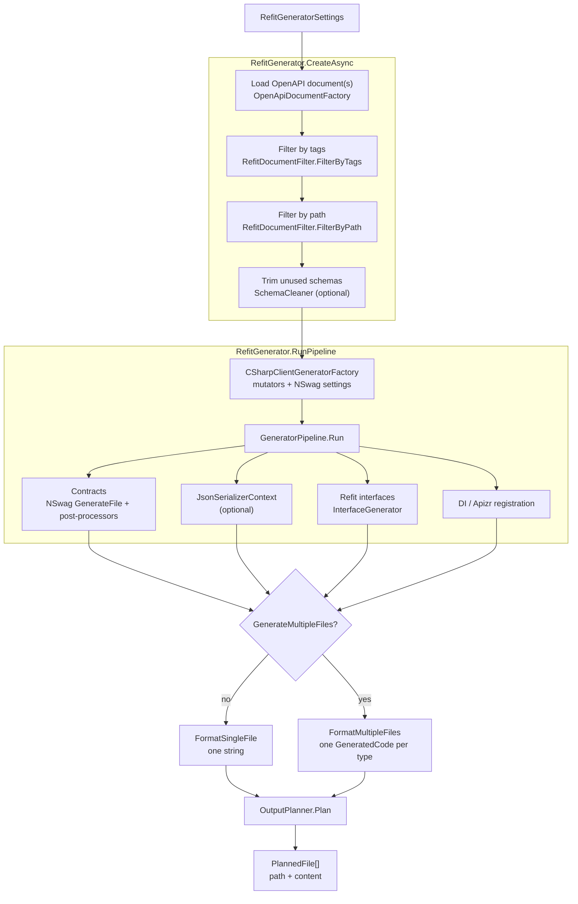
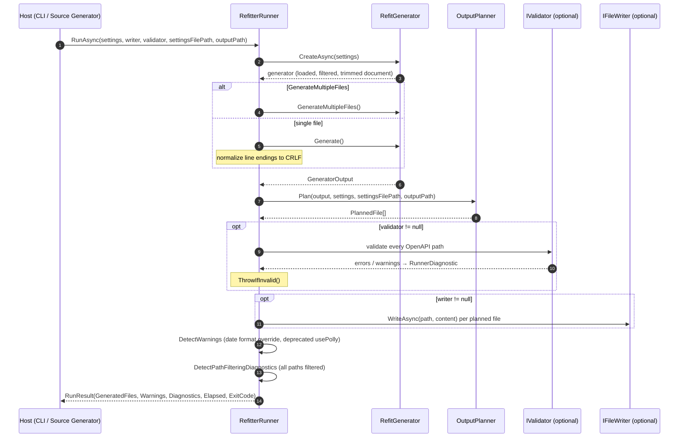
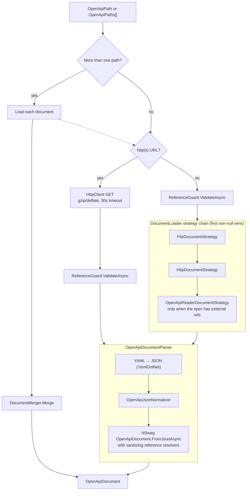
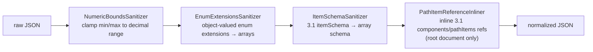
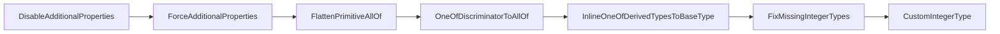
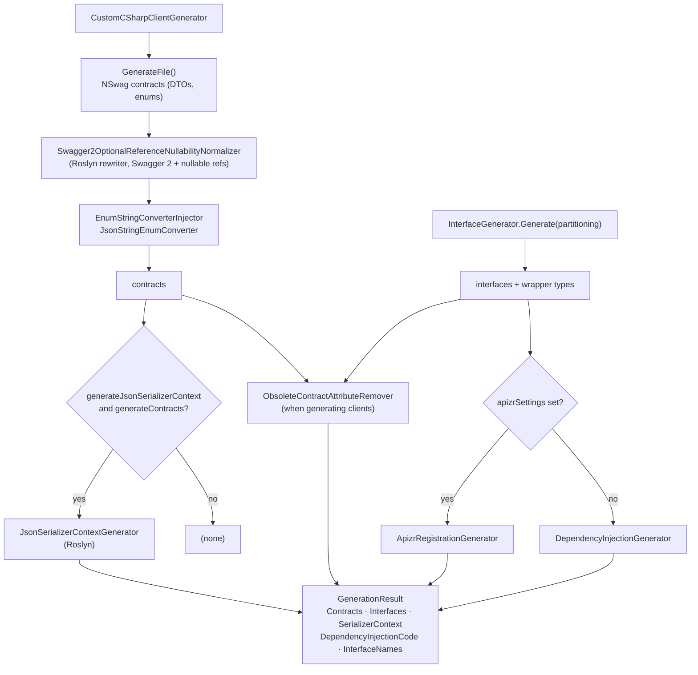
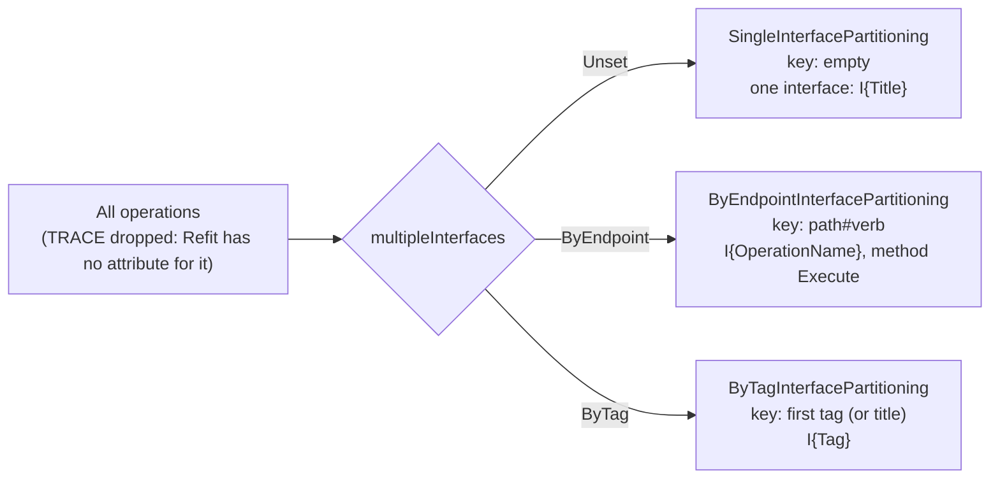
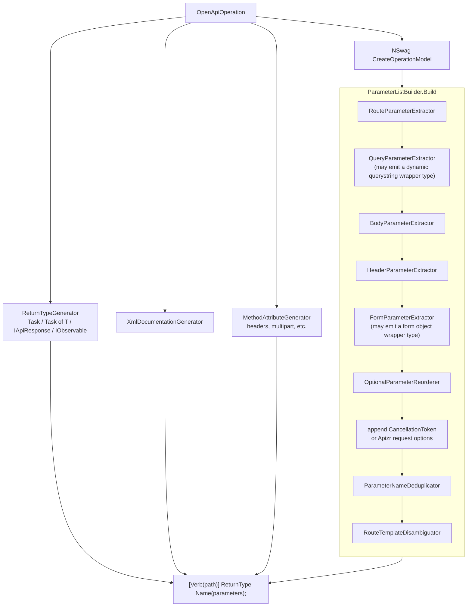
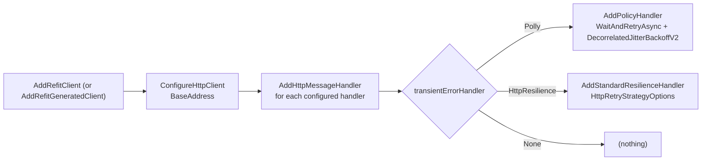
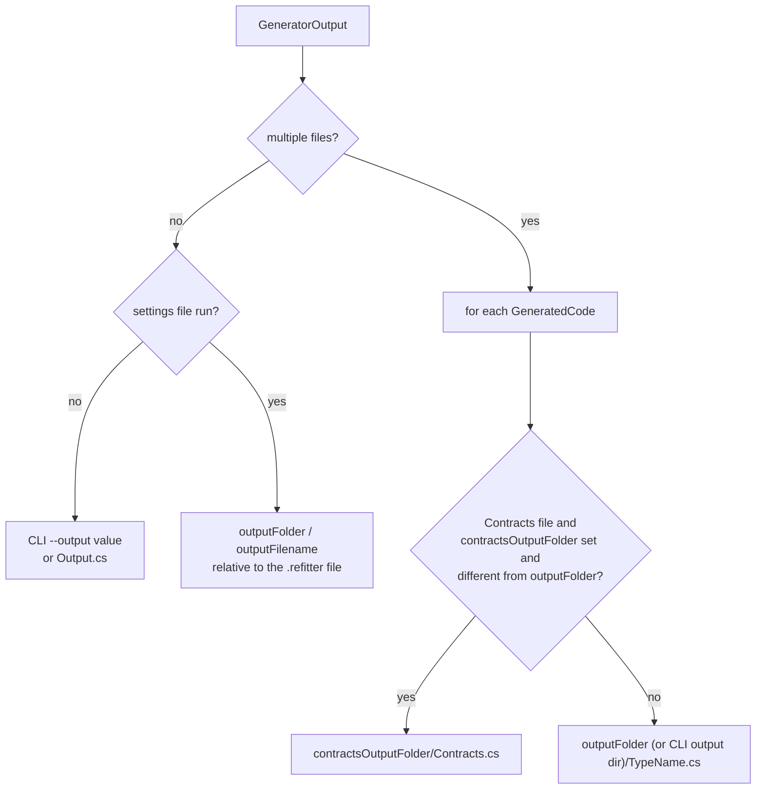

# Code Generation Pipeline

All code generation happens in `Refitter.Core`. The CLI, the MSBuild task (through the CLI) and the source generator all call the same pipeline. This page follows a `RefitGeneratorSettings` object from the moment it reaches [`RefitterRunner`](https://github.com/christianhelle/refitter/blob/main/src/Refitter.Core/RefitterRunner.cs) until generated C# source comes back.

## The big picture

## RefitterRunner

[`RefitterRunner.RunAsync`](https://github.com/christianhelle/refitter/blob/main/src/Refitter.Core/RefitterRunner.cs) is the single entry point used by every host. The order of steps matters: code is generated and the output is planned **before** the specification is validated, but files are only written **after** validation succeeds. A spec that fails validation never leaves half-written output behind.

`RunAsync` catches every exception. On failure it returns an empty file list, appends the exception message as an error `RunnerDiagnostic`, and sets `ExitCode` to the exception's `HResult`. The host decides how to surface that: the CLI prints it and exits with a non-zero code, and the source generator reports `REFITTER000`.

## Loading the OpenAPI document

Loading lives in the [`Document`](https://github.com/christianhelle/refitter/tree/main/src/Refitter.Core/Document) folder. The result is always a single NSwag `OpenApiDocument`, regardless of whether the input was one file, a URL, or several specifications.

### Reference guard

Before a specification is parsed, [`ReferenceGuard`](https://github.com/christianhelle/refitter/blob/main/src/Refitter.Core/Document/ReferenceGuard.cs) scans its `$ref` values. It enforces two separate rules:

- Remote `http(s)` references are rejected, to avoid server-side request forgery when Refitter runs on a build server. Setting `allowRemoteReferences` in the `.refitter` file allows them.
- Local file references (absolute or `../`) that resolve outside the input specification's directory tree are always rejected. `allowRemoteReferences` does not change this; move the referenced files under the specification's directory instead.

### Loading strategies

[`DocumentLoader`](https://github.com/christianhelle/refitter/blob/main/src/Refitter.Core/Document/DocumentLoader.cs) tries a chain of `IDocumentLoadingStrategy` implementations:

1. `FileDocumentStrategy` parses a local file with NSwag.
2. `HttpDocumentStrategy` downloads the document with a `refitter/<version>` user agent.
3. `OpenApiReaderDocumentStrategy` only acts when the specification contains external references. It uses Microsoft.OpenApi's multi-file reader (via OasReader) to inline them into one document, fills in a missing `info.title` / `info.version`, serializes the result back in its original OpenAPI version and re-parses it with NSwag.

### Normalizing the JSON

NSwag was written for OpenAPI 2.0 and 3.0. [`OpenApiJsonNormalizer`](https://github.com/christianhelle/refitter/blob/main/src/Refitter.Core/Document/OpenApiJsonNormalizer.cs) parses the raw JSON once and rewrites constructs NSwag can't handle before NSwag sees them:

Externally referenced files go through the same normalization, because the parser installs `SanitizingJsonReferenceResolver` / `SanitizingYamlReferenceResolver` as NSwag's reference resolvers.

### Merging multiple specifications

When `openApiPaths` lists several specifications, [`DocumentMerger`](https://github.com/christianhelle/refitter/blob/main/src/Refitter.Core/Document/DocumentMerger.cs) clones the first document and merges paths, component schemas, definitions and security definitions from the rest. Tags are de-duplicated by name. A key that appears in two documents is only accepted when [`DocumentEquivalenceComparer`](https://github.com/christianhelle/refitter/blob/main/src/Refitter.Core/Document/DocumentEquivalenceComparer.cs) considers both definitions identical; otherwise merging fails fast with an `InvalidOperationException` instead of silently picking one.

## Filtering and trimming

[`RefitGenerator.CreateAsync`](https://github.com/christianhelle/refitter/blob/main/src/Refitter.Core/Pipeline/RefitGenerator.cs) then narrows the document:

- **`RefitDocumentFilter.FilterByTags`** keeps only operations with one of the `includeTags`.
- **`RefitDocumentFilter.FilterByPath`** keeps only paths matching one of the `includePathMatches` regular expressions (evaluated with a 1 second regex timeout).
- **`SchemaCleaner.RemoveUnreferencedSchema`** runs when `trimUnusedSchema` is enabled. [`SchemaWalker`](https://github.com/christianhelle/refitter/blob/main/src/Refitter.Core/Schema/SchemaWalker.cs) collects every schema reachable from the remaining operations, and everything else is removed, except schemas matching `keepSchemaPatterns`. With `includeInheritanceHierarchy` disabled, discriminator mappings that point at removed types are pruned too.

Each filter works on a clone of the document (`ToJson()` / `FromJsonAsync()`), so the original is never mutated. If path filtering removes every path, `RefitterRunner` reports an `AllPathsFiltered` diagnostic instead of silently producing an empty interface.

## Preparing NSwag

[`CSharpClientGeneratorFactory`](https://github.com/christianhelle/refitter/blob/main/src/Refitter.Core/Pipeline/CSharpClientGeneratorFactory.cs) first runs a fixed chain of document mutators. Each mutator rewrites schemas into a shape NSwag generates good contracts for:

It then builds NSwag's `CSharpClientGeneratorSettings`. NSwag is used **only for contracts**: `GenerateClientClasses`, `GenerateClientInterfaces` and `GenerateExceptionClasses` are all `false`, `GenerateDtoTypes` is `true`, and the JSON library is System.Text.Json. Refitter also plugs in its own naming components (`UniquePropertyNameGenerator`, `SafeSchemaTypeNameGenerator`, `UniqueEnumNameGenerator`, optionally `PreserveOriginalPropertyNameGenerator`) and a `CustomTemplateFactory` that patches NSwag's class template, for example for polymorphic serialization attributes. The `codeGeneratorSettings` section of the `.refitter` file is copied onto these settings.

The result is a [`CustomCSharpClientGenerator`](https://github.com/christianhelle/refitter/blob/main/src/Refitter.Core/CodeGeneration/CustomCSharpClientGenerator.cs), a subclass of NSwag's `CSharpClientGenerator` that exposes NSwag's operation models and type resolver to Refitter.

## GeneratorPipeline

[`GeneratorPipeline.Run`](https://github.com/christianhelle/refitter/blob/main/src/Refitter.Core/Pipeline/GeneratorPipeline.cs) produces the four parts of the output:

### Interface partitioning

`multipleInterfaces` decides how operations are grouped into Refit interfaces. Each mode is an [`IInterfacePartitioning`](https://github.com/christianhelle/refitter/tree/main/src/Refitter.Core/Partitioning) implementation that returns a group key per operation.

Interface names are de-duplicated against the generated contract type names (adding an `Endpoint` or `Api` suffix where needed), and in multi-interface modes, when `generateDeprecatedOperations` is `false`, a group whose operations are all deprecated is skipped.

### Generating a method

For every operation, [`InterfaceGenerator`](https://github.com/christianhelle/refitter/blob/main/src/Refitter.Core/Generation/InterfaceGenerator.cs) asks NSwag for its `CSharpOperationModel` and then builds the Refit method around it:

When Apizr is enabled together with `optionalParameters`, an extra overload without the optional parameters is emitted. Wrapper types created for dynamic querystrings and form objects are returned alongside the interfaces as non-interface `GeneratedCode` entries, so they end up in their own files in multi-file mode.

### Dependency injection registration

When `dependencyInjectionSettings` is set, [`DependencyInjectionGenerator`](https://github.com/christianhelle/refitter/blob/main/src/Refitter.Core/Pipeline/DependencyInjectionGenerator.cs) emits an `IServiceCollection` extension method that registers every generated interface:

With `apizrSettings`, [`ApizrRegistrationGenerator`](https://github.com/christianhelle/refitter/blob/main/src/Refitter.Core/Apizr/ApizrRegistrationGenerator.cs) emits either a `Configure...ApizrManager(s)` extension (DI) or a static `Build...ApizrManager(s)` method, composed from adapters for caching, mapping, mediation, file transfer, retry, priority and handlers.

## Formatting the output

`RefitGenerator` formats the `GenerationResult` in one of two ways.

**Single file** (`FormatSingleFile`) concatenates, in order: interfaces (if `generateClients`), contracts (if `generateContracts`, with namespace prefixes already imported by the interface file removed), the serializer context, and the DI code. The contract type suffix is then applied, and `RefitterRunner` normalizes line endings to CRLF.

**Multiple files** (`FormatMultipleFiles`) returns one `GeneratedCode` per interface or wrapper type, plus `Contracts`, the serializer context type and `DependencyInjection`. Every file is named `{TypeName}.cs`.

## Planning the output paths

[`OutputPlanner`](https://github.com/christianhelle/refitter/blob/main/src/Refitter.Core/Pipeline/OutputPlanner.cs) turns generated code into `PlannedFile` objects. For settings-file runs, paths are resolved against the `.refitter` file's directory. For direct CLI runs, the `--output` value (or `Output.cs`) is used as given, so it may be relative to the current directory. The planner only computes paths; whether they are written is up to the host.

Setting `contractsOutputFolder` implies multiple files: [`RefitterSettingsLoader.ApplyDefaults`](https://github.com/christianhelle/refitter/blob/main/src/Refitter.Core/Settings/RefitterSettingsLoader.cs) turns on `generateMultipleFiles` in that case, and defaults `outputFilename` to `<name of the .refitter file>.cs`.

## Warnings and diagnostics

After generation, `RefitterRunner` adds:

| Kind | When |
|---|---|
| `WarningKind.DateFormatOverride` | `dateFormat` is set but ignored because `useIsoDateFormat` is enabled |
| `WarningKind.DeprecatedSetting` | The deprecated `usePolly` setting is used |
| `RunnerDiagnosticKind.AllPathsFiltered` | `includePathMatches` removed every path from the specification |
| Validation diagnostics | Errors and warnings from the optional `IValidator` |

Hosts decide which of these to surface. The CLI prints warnings, the all-paths-filtered warning and diagnostics, and `Refitter.MSBuild` inherits that output through the CLI. The source generator reports error diagnostics as `REFITTER000` and the date-format warning as `REFITTER002`, but it does **not** report `AllPathsFiltered`, so a filter that removes every path silently produces an empty interface there.

## Validation

Validation is optional and pluggable through `IValidator`. The CLI's [`OpenApiValidatorAdapter`](https://github.com/christianhelle/refitter/tree/main/src/Refitter.Core/Validation) runs the reference guard, loads the specification with Microsoft.OpenApi (independently of NSwag), walks it to collect statistics (paths, operations, schemas and so on, shown by the CLI), and checks strings that end up inside C# attributes. Errors make `ThrowIfInvalid()` throw an `OpenApiValidationException` before anything is written.
