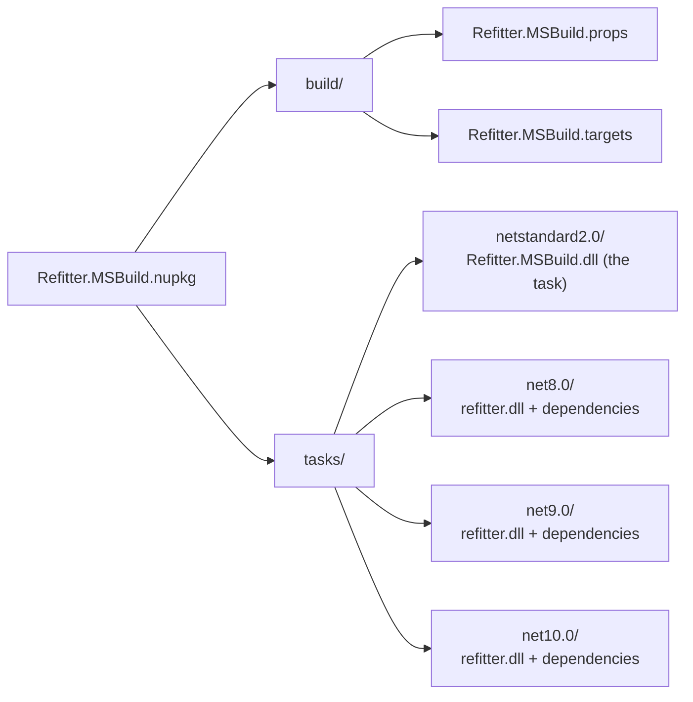
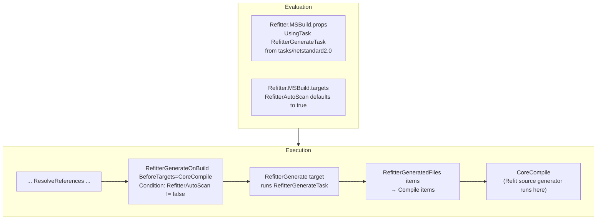
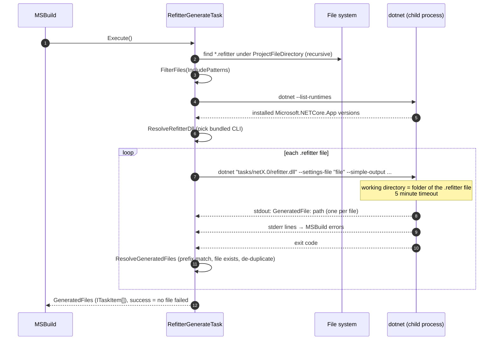
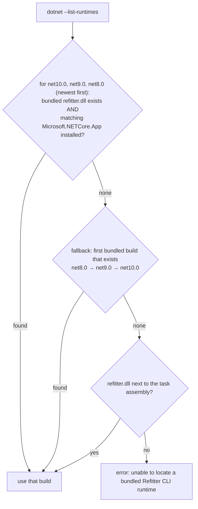

# MSBuild Task Internals

`Refitter.MSBuild` generates code during `dotnet build` from every `.refitter` file in a project. Usage is described in [MSBuild](../msbuild.md). This page explains how it works.

The key design decision: **the MSBuild task does not contain the code generator.** It ships the complete Refitter CLI for several .NET runtimes and starts it as a `dotnet` child process. That keeps NSwag, Microsoft.OpenApi, Roslyn and their dependencies out of the MSBuild process, where assembly version conflicts with MSBuild's own dependencies (and with other tasks) would otherwise be likely, and it lets the task assembly stay a small `netstandard2.0` library that loads in both `dotnet build` and Visual Studio's .NET Framework MSBuild.

## Package layout



[`Refitter.MSBuild.csproj`](https://github.com/christianhelle/refitter/blob/main/src/Refitter.MSBuild/Refitter.MSBuild.csproj) has no project reference to the CLI. It packs the CLI's existing build output (`../Refitter/bin/$(Configuration)/<tfm>/**`) into `tasks/<tfm>`, so the CLI has to be built before the package is packed. The CI workflows do exactly that: build the solution, then `dotnet pack --no-build`.

## Where it hooks into the build



The `RefitterGenerate` target can also be run on its own with `dotnet build -t:RefitterGenerate`, which is how generation still works when `RefitterAutoScan` is `false`.

MSBuild properties map to task parameters:

| MSBuild property | Task parameter | Effect |
|---|---|---|
| `$(MSBuildProjectDirectory)` | `ProjectFileDirectory` | Root folder scanned for `.refitter` files |
| `RefitterNoLogging` | `DisableLogging` | Passes `--no-logging` to the CLI |
| `RefitterSkipValidation` | `SkipValidation` | Passes `--skip-validation` to the CLI |
| `RefitterIncludePatterns` | `IncludePatterns` | Limits which `.refitter` files are used |
| `RefitterJsonLibraryVersion` | `JsonLibraryVersion` | Passes `--json-library-version` to the CLI |

Because the generated files are added as `Compile` items before `CoreCompile`, the regular Refit source generator in the consuming project sees them like any hand-written file. No special handling is needed, unlike in the [source generator](source-generator-internals.md#running-refit-and-systemtextjson-generators).

## What RefitterGenerateTask does

[`RefitterGenerateTask`](https://github.com/christianhelle/refitter/blob/main/src/Refitter.MSBuild/RefitterGenerateTask.cs):



### Selecting .refitter files

The task scans the project folder recursively for `*.refitter`. When `RefitterIncludePatterns` is set, it is split on `;` and each entry is compared **case-insensitively and exactly** (not as a glob) to the file name, the path relative to the project folder, or the full path. Slashes are normalized and a leading `./` is ignored. This is how multi-targeting projects pick a different `.refitter` file per target framework.

### Selecting a CLI runtime

The CLI is a framework-dependent application, so the task has to choose a build that matches a runtime installed on the machine:



The chosen runtime is also passed to the CLI as `--telemetry-runtime`.

### Running the CLI

The command line is:

```shell
dotnet "<package>/tasks/<tfm>/refitter.dll" --settings-file "<file>.refitter" --simple-output \
  --telemetry-source msbuild --telemetry-file-count <N> [--telemetry-runtime <tfm>] \
  [--no-logging] [--skip-validation] [--json-library-version <X>]
```

The process runs without a shell, in the folder of the `.refitter` file, with stdout and stderr redirected. It is killed after 5 minutes.

### The GeneratedFile contract

With `--simple-output`, the CLI's [`SimpleGenerationReporter`](cli-internals.md#reporters) prints one line per written file:

```text
GeneratedFile: C:\src\MyApp\Generated\Petstore.cs
```

The task does not try to predict output paths from the `.refitter` file. It trusts what the CLI reports: lines with the `GeneratedFile: ` prefix whose file exists are collected and de-duplicated (case-insensitively), and become the task's `GeneratedFiles` output. That way `outputFolder`, `outputFilename`, `contractsOutputFolder` and `generateMultipleFiles` are always resolved by exactly the same `OutputPlanner` code as in the CLI.

### Error handling

| Situation | Result |
|---|---|
| Line written to stderr | Logged as an MSBuild **error** |
| Non-zero exit code | That `.refitter` file fails |
| Process exceeds 5 minutes | Process is killed; that file fails |
| Exit code 0 but no `GeneratedFile:` lines | Error: Refitter did not report any generated files. This also happens when the `.refitter` file sets `"silent": true`, because the CLI then uses the silent reporter even with `--simple-output`. Don't use `silent` with `Refitter.MSBuild` |
| Invalid `RefitterJsonLibraryVersion` | Error before the CLI is started |
| No usable CLI runtime found | Error for each file |

The task keeps processing the remaining files after a failure and returns `false` at the end if any file failed, so one build shows every problem at once. The CLI's [exit code mapping](cli-internals.md#errors-and-exit-codes) makes sure failures are never reported as exit code 0.

## Incremental builds

The `RefitterGenerate` target has no `Inputs`/`Outputs` and no up-to-date check: every build runs the CLI once per `.refitter` file. Generation is usually fast, and always regenerating avoids stale output when a remote OpenAPI specification changes. If that cost matters, set `RefitterAutoScan` to `false` and run `dotnet build -t:RefitterGenerate` when the specification changes, and also before the first build in any fresh checkout or clean environment (for example on CI), where no generated files exist yet. Note that the `Compile` items are only added inside the build that runs `RefitterGenerate`; they don't persist to later builds. With auto-scan off, later normal builds only compile the generated files if the SDK picks them up by default (output in the project folder) or the project includes them explicitly. Output under `obj`, as recommended for multi-targeting, is not included by default, so add a `<Compile Include="obj/..." />` item for it.

## Testability

The task's interactions with the outside world (starting processes, listing runtimes, killing processes, checking whether files exist, and the timeout) are exposed as internal `AsyncLocal` overrides. The unit tests in [`src/Refitter.Tests/MSBuild`](https://github.com/christianhelle/refitter/tree/main/src/Refitter.Tests/MSBuild) use them to test runtime selection, argument building, output parsing, timeouts and error handling without starting `dotnet`. The real package is tested end-to-end by the [MSBuild package tests](testing.md#msbuild-package-tests).
