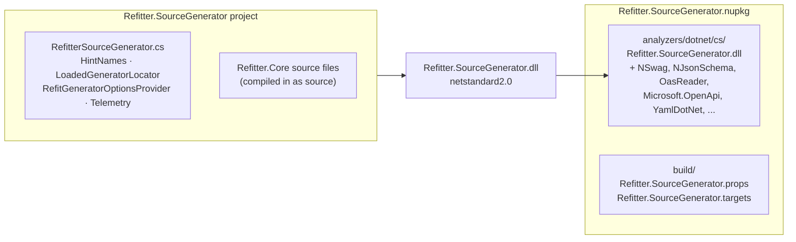
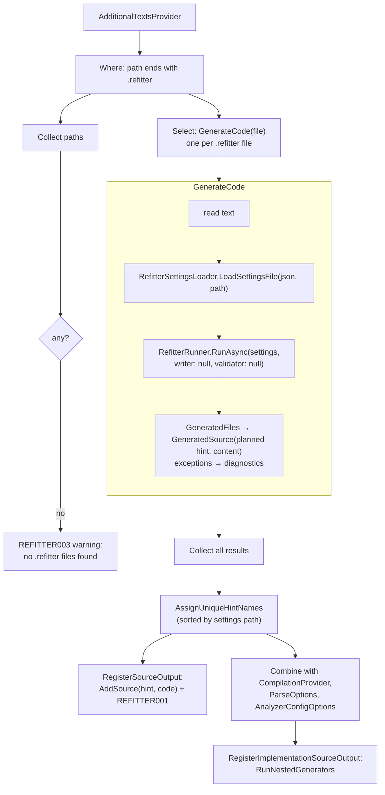
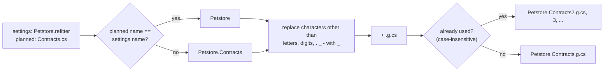
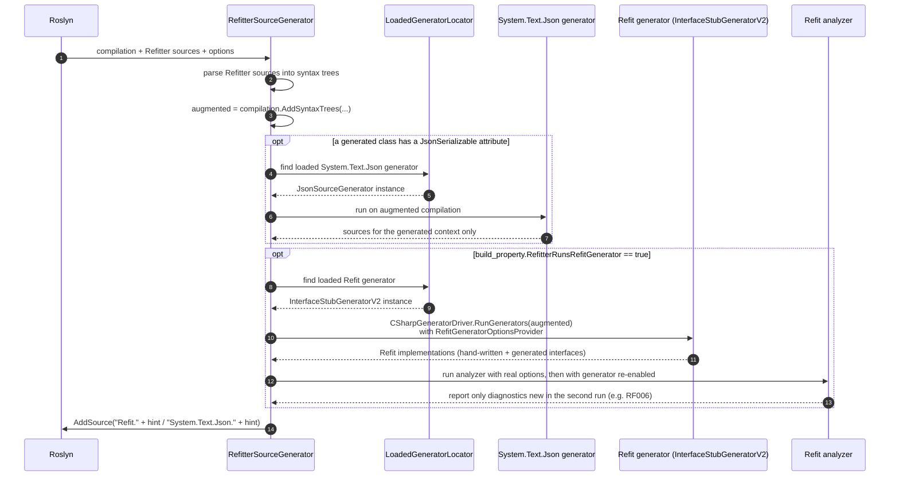
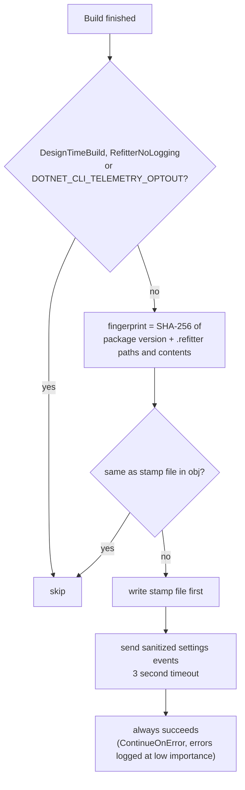

# Source Generator Internals

`Refitter.SourceGenerator` runs the Refitter code generator inside the C# compiler. Usage is described in [Source Generator](../source-generator.md). This page explains how it is built, how the incremental pipeline works, and how it cooperates with Refit's own source generator.

## Package and assembly layout

Roslyn loads analyzers and source generators into the compiler process (and the IDE) with limited support for dependencies. The generator therefore ships as a self-contained analyzer:

- `Refitter.Core` is not referenced as a package. Its source files are included folder by folder (`<Compile Include="../Refitter.Core/Pipeline/*.cs" />` and so on), so the generator contains its own copy of the code generator.
- Third-party dependencies are referenced with `PrivateAssets="all"` and packed next to the generator in `analyzers/dotnet/cs` (using H.Generators.Extensions), where the compiler can load them.
- `Refit` is referenced privately. At build time the generator does **not** use its own copy of Refit's generator: it uses the one the consuming project's `Refit` package already loaded into the compiler. This is why consuming projects must reference `Refit` directly.
- The package is a development dependency, so it doesn't flow to consumers of your library.

## MSBuild integration

The package's `build` files do two small things before the compiler runs:

| File | What it does |
|---|---|
| [`Refitter.SourceGenerator.props`](https://github.com/christianhelle/refitter/blob/main/src/Refitter.SourceGenerator/Refitter.SourceGenerator.props) | `<AdditionalFiles Include="**/*.refitter" />`, so every `.refitter` file in the project reaches the generator |
| [`Refitter.SourceGenerator.targets`](https://github.com/christianhelle/refitter/blob/main/src/Refitter.SourceGenerator/Refitter.SourceGenerator.targets) | Unless the project already disabled it, sets `DisableRefitSourceGenerator=true` and `RefitterRunsRefitGenerator=true` (exposed to the generator as a `CompilerVisibleProperty`). Also registers the post-build telemetry task |

The `DisableRefitSourceGenerator` logic lives in a `.targets` file on purpose: `.targets` files are imported after the project body, so a project that sets `DisableRefitSourceGenerator` to `true` itself (for example when using `Refit.Reflection`) is detected and left alone.

## The incremental pipeline

[`RefitterSourceGenerator`](https://github.com/christianhelle/refitter/blob/main/src/Refitter.SourceGenerator/RefitterSourceGenerator.cs) is an `IIncrementalGenerator`. Roslyn caches every stage, so when an unrelated `.cs` file changes, the `.refitter` files are not reprocessed.

`RefitterRunner` is called without an `IFileWriter`, so nothing is written to disk from inside the compiler, and without an `IValidator`, so the specification is not validated with Microsoft.OpenApi. The `outputFolder` / `outputFilename` settings are only used to compute hint names. Use `<EmitCompilerGeneratedFiles>true</EmitCompilerGeneratedFiles>` to see the output on disk.

### Hint names

Roslyn requires every `AddSource` hint name in a compilation to be unique. [`HintNames`](https://github.com/christianhelle/refitter/blob/main/src/Refitter.SourceGenerator/HintNames.cs) derives them from the `.refitter` file name and the planned output file name:

Results are sorted by settings file path (ordinal) before names are assigned, so hint names are stable between builds even when two `.refitter` files in different folders share a name.

## Running Refit and System.Text.Json generators

Roslyn runs all source generators against the **same input compilation**. Generators don't see each other's output. Without extra work, Refit's source generator would never see the interfaces Refitter adds, so they would get no generated Refit implementations. Likewise the System.Text.Json source generator would not see a generated `JsonSerializerContext`.

Refitter solves this by running those generators itself, over an augmented compilation:

The details that make this work:

- **The consumer's Refit generator is disabled** by the package's `.targets` (`DisableRefitSourceGenerator=true`), so Refit implementations are not generated twice. Because Refitter's nested run covers the whole augmented compilation, hand-written Refit interfaces in the same project still get implementations.
- **[`RefitGeneratorOptionsProvider`](https://github.com/christianhelle/refitter/blob/main/src/Refitter.SourceGenerator/RefitGeneratorOptionsProvider.cs)** wraps the project's analyzer config options and answers `"false"` for `build_property.DisableRefitSourceGenerator`, re-enabling Refit's generator only inside the nested run.
- **[`LoadedGeneratorLocator`](https://github.com/christianhelle/refitter/blob/main/src/Refitter.SourceGenerator/LoadedGeneratorLocator.cs)** finds the generator types in assemblies already loaded in the compiler process by the consumer's packages, so the Refit and System.Text.Json versions always match the ones the project references. A shared compiler server can have several versions loaded at once, so it picks the newest loaded version with the same major version as the compilation's reference. If the generator can't be found, `REFITTER006` / `REFITTER008` is reported.
- **Refit analyzer diagnostics** such as `RF006` are normally only reported while Refit's generator is enabled. Refitter runs the Refit analyzer twice, with the real options and with the generator re-enabled, and reports only the extra diagnostics from the second run, so nothing is reported twice.
- **Diagnostic locations**: diagnostics from nested generators may point into syntax trees that only exist inside the nested run. Those are moved to `Location.None`, with the original `path:line` appended to the message.

## Diagnostics

All diagnostics use the category `Refitter`.

| ID | Severity | Meaning |
|---|---|---|
| `REFITTER000` | Error | A `.refitter` file couldn't be read or deserialized, or generation failed |
| `REFITTER001` | Info | A source file was generated |
| `REFITTER002` | Warning | `dateFormat` is ignored because `useIsoDateFormat` is enabled |
| `REFITTER003` | Warning | No `.refitter` files were found |
| `REFITTER004` | Info | A `.refitter` file was found |
| `REFITTER005` | Info | Contents of a `.refitter` file |
| `REFITTER006` | Warning | Refit's source generator couldn't be found; add a direct `Refit` package reference |
| `REFITTER007` | Error | A nested generator or the Refit analyzer threw an exception |
| `REFITTER008` | Warning | The System.Text.Json source generator couldn't be found |

## Telemetry

The source generator itself never makes network calls. Telemetry is sent by [`RefitterTelemetryTask`](https://github.com/christianhelle/refitter/tree/main/src/Refitter.SourceGenerator/Telemetry), an MSBuild task in the same assembly that runs after `Build`:

The stamp is written before sending so machines without network access don't retry on every build.

## How it is tested

The source generator has its own test project that references the generator as an analyzer and imports its `.targets`, so the tests exercise the real package behaviour, including the nested Refit generator. See [Source generator tests](testing.md#source-generator-tests).
