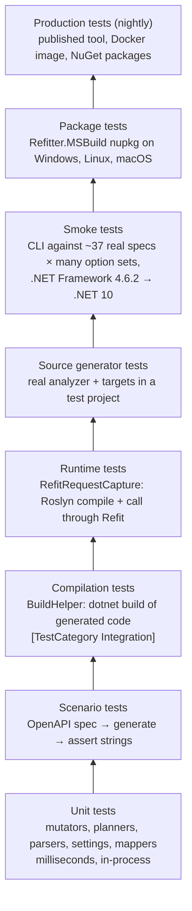
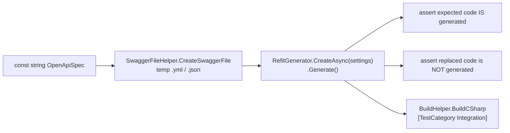
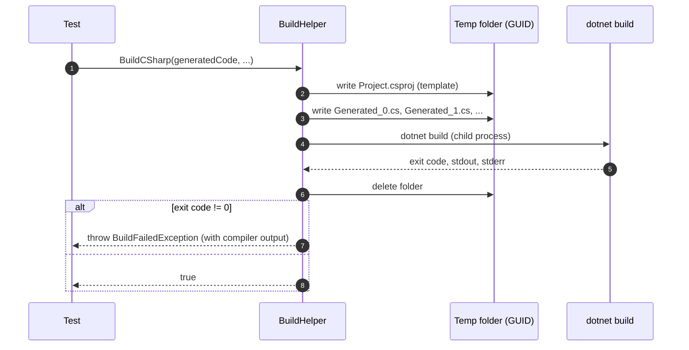
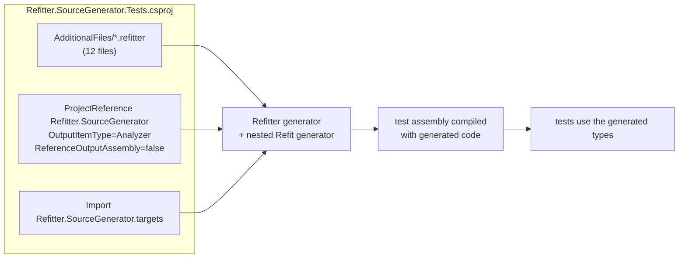
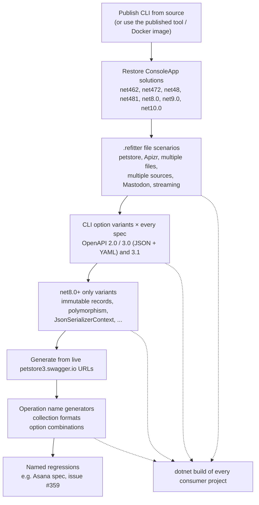
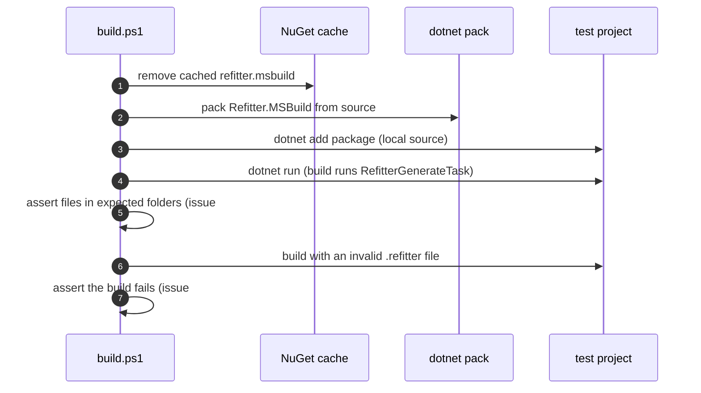
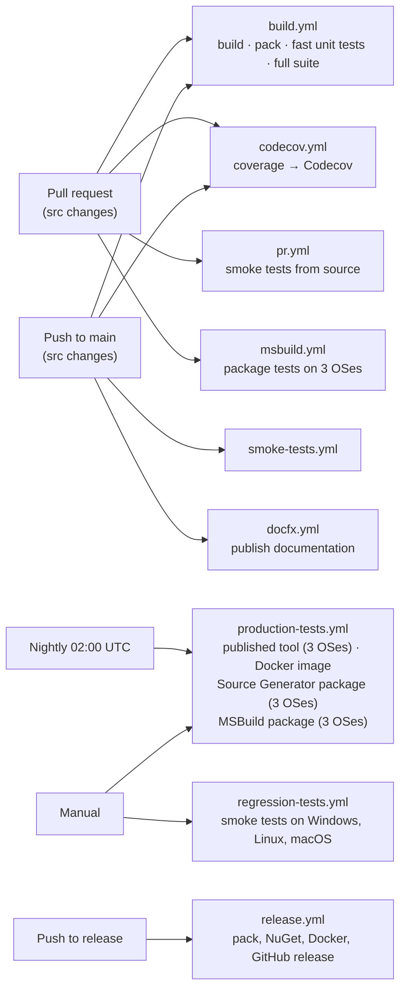

# Testing and Regression Prevention

Refitter turns third-party OpenAPI documents, which vary a lot in quality and style, into C# that has to compile under several target frameworks and work with Refit at runtime. A string comparison of generated output can't prove that. Refitter's tests are therefore layered: fast unit tests, scenario tests that compile the generated code, runtime checks through Refit, tests of the real NuGet packages, smoke tests against real-world specifications, and nightly tests of the published packages.

## The test layers



Lower layers run on every build and give feedback in seconds. Upper layers are slower but test what users actually install.

| Layer | Where | When it runs |
|---|---|---|
| Unit, scenario, compilation, runtime | `src/Refitter.Tests` | Every build and pull request |
| Source generator | `src/Refitter.SourceGenerator.Tests` | Every build and pull request |
| Smoke tests | `test/smoke-tests.sh`, `test/ConsoleApp` | Pull requests and pushes to `main` that change generator code; on demand on Windows, Linux and macOS |
| MSBuild package | `test/MSBuild` | Pull requests touching the MSBuild task, on Windows, Linux and macOS |
| Production | `.github/workflows/production-tests.yml` | Nightly, and on demand |

## Refitter.Tests

`src/Refitter.Tests` is the main test project: roughly 330 test files and over 2,500 test methods (many more test cases once `[DataRow]` expansions are counted).

- **Framework:** MSTest v4 on [Microsoft.Testing.Platform](https://learn.microsoft.com/dotnet/core/testing/microsoft-testing-platform-intro). The project is an executable (`OutputType=Exe`, `EnableMSTestRunner=true`).
- **Assertions:** [AwesomeAssertions](https://awesomeassertions.org/) (`generatedCode.Should().Contain(...)`).
- **Parallelism:** `[assembly: Parallelize(Scope = ExecutionScope.MethodLevel, Workers = 0)]` runs test methods in parallel on every CPU core. Tests that touch global state use `[DoNotParallelize]`. Every test writes to its own GUID-named temporary folder, so tests don't interfere with each other.

| Folder | Focus |
|---|---|
| `Scenarios/` | Feature tests, each with its own inline OpenAPI specification (the largest group, ~180 files) |
| `Regression/` | Tests named after the bug they reproduce, for example `Issue1190DynamicQueryParamsByTagTests` |
| `OpenApi/` | Document loading, sanitizers, merging, `$ref` resolution, URL loading |
| `Apizr/` | Apizr output and registration |
| `Parameters/` | Parameter extraction and ordering |
| `DependencyInjection/` | DI registration with handlers, Polly and HttpResilience |
| `SettingsFile/` | `.refitter` loading and serialization, consistency with the JSON schema |
| `MSBuild/` | `RefitterGenerateTask` with faked processes and runtimes |
| `SourceGenerator/` | Hint name generation |
| root | Generators, planners, reporters, CLI command, `RefitterRunner`, Swagger Petstore end-to-end tests |

### Anatomy of a scenario test

Every new feature gets a scenario test in the `Refitter.Tests.Scenarios` namespace. The pattern is always the same: an OpenAPI specification as a `const string`, a generation step, string assertions, and a compilation check. A simplified version of [`ArrayTypeReturnTests`](https://github.com/christianhelle/refitter/blob/main/src/Refitter.Tests/Scenarios/ArrayTypeReturnTests.cs):

```csharp
[TestClass]
public class ArrayTypeReturnTests
{
    private const string OpenApiSpec = @"
openapi: '3.0.0'
paths:
  /jobs:
    get:
      responses:
        '200':
          content:
            application/json:
              schema:
                type: 'array'
                items:
                  $ref: '#/components/schemas/JobResponse'
...";

    [TestMethod]
    public async Task Returns_IList()
    {
        string generatedCode = await GenerateCode();
        generatedCode.Should().Contain("IList<JobResponse>");
    }

    [TestMethod]
    [TestCategory("Integration")]
    public async Task Can_Build_Generated_Code()
    {
        string generatedCode = await GenerateCode();
        BuildHelper.BuildCSharp(generatedCode).Should().BeTrue();
    }

    private static async Task<string> GenerateCode()
    {
        var swaggerFile = await SwaggerFileHelper.CreateSwaggerFile(OpenApiSpec);
        var settings = new RefitGeneratorSettings
        {
            OpenApiPath = swaggerFile,
            CodeGeneratorSettings = new CodeGeneratorSettings { ArrayType = "System.Collections.Generic.IList" }
        };
        var sut = await RefitGenerator.CreateAsync(settings);
        return sut.Generate();
    }
}
```



A test that only looks for a string can pass on code that doesn't compile, so the compilation check is required by the project's Definition of Done.

### Compiling generated code: BuildHelper

[`BuildHelper`](https://github.com/christianhelle/refitter/blob/main/src/Refitter.Tests/Build/BuildHelper.cs) checks that generated code compiles with a real `dotnet build`, against real package references:



The project template references `Refit.HttpClientFactory`, `System.Text.Json`, the `Microsoft.Extensions` DI, Polly and HTTP resilience packages and the Apizr packages, with XML documentation generation enabled. Variants cover other situations:

| Method | Builds |
|---|---|
| `BuildCSharp(code)` | `net8.0` (the lowest supported modern target) |
| `BuildCSharp(warningsAsErrors: true, ...)` | With warnings treated as errors, for example to catch missing XML documentation |
| `BuildCSharpForTargetFramework("net9.0" / "net10.0", ...)` | Newer target frameworks |
| `BuildApizrCSharp` | Against the Apizr packages |
| `BuildRefit11CSharp` | Against an older Refit major version |
| `BuildCSharpWithoutImplicitUsings` | With implicit usings disabled, to catch missing `using` directives |

Because these tests start `dotnet build`, they are much slower than the rest, and they are the only tests marked `[TestCategory("Integration")]`. That allows a fast feedback loop:

```shell
# unit tests only (seconds)
dotnet test --filter "TestCategory!=Integration" --solution src/Refitter.slnx -c Release --no-build

# full suite
dotnet test --solution src/Refitter.slnx -c Release
```

### Checking runtime behaviour: RefitRequestCapture

Compiling is not the same as working. Refit validates interfaces when a client is created, and parameter attributes decide the URL, query string, headers and body of the request. [`RefitRequestCapture`](https://github.com/christianhelle/refitter/blob/main/src/Refitter.Tests/TestUtilities/RefitRequestCapture.cs) compiles generated code in memory with Roslyn (optionally running Refit's own source generator over it, to compare the generated-client and reflection code paths), creates a Refit client with a capturing `HttpMessageHandler`, calls a generated method and returns the `HttpRequestMessage` Refit produced. Tests then assert on the actual HTTP request.

### Other helpers

| Helper | Purpose |
|---|---|
| [`SwaggerFileHelper`](https://github.com/christianhelle/refitter/blob/main/src/Refitter.Tests/TestUtilities/SwaggerFileHelper.cs) | Writes a specification string to a unique temporary `.yml` or `.json` file |
| `TestDirectory` | One temporary root per test run under `%TEMP%/refitter-tests/`, deleted on assembly cleanup |
| `LocalHttpServer` | A loopback HTTP server, to test loading specifications from URLs without the internet |
| `EmbeddedResources` | Swagger Petstore v2 and v3 variants (JSON and YAML, with different authentication headers, illegal paths and titles) used by `[DataRow]` tests across every sample |

### Regression tests

Every bug fix comes with a test that fails without the fix. Small fixes add cases to the relevant scenario test; larger ones get a dedicated class in [`Regression/`](https://github.com/christianhelle/refitter/tree/main/src/Refitter.Tests/Regression), named after the issue or symptom (for example `ContractSuffixCorruptionTests`, `MalformedUnicodeEscapeTests`, `XmlDocEscapingTests`). The smoke tests and MSBuild package tests also contain checks named after specific GitHub issues.

## Source generator tests

`src/Refitter.SourceGenerator.Tests` (targeting `net8.0` and `net10.0`) tests the generator the way a consuming project uses it:



- The generator is referenced as an analyzer and its `.targets` file is imported explicitly, because a project reference doesn't import a package's build files. This makes the test build behave like a project consuming the NuGet package, including the [Refit generator handoff](source-generator-internals.md#running-refit-and-systemtextjson-generators).
- The `.refitter` files cover multiple interfaces (by endpoint and by tag), optional parameters, Polly and HttpResilience, `JsonSerializerContext`, property naming policies, polymorphic serialization, custom output folders and two settings files with the same name in different folders (for hint name collisions).
- Many checks happen at compile time: if the expected types weren't generated, the test project doesn't build. The tests then check namespaces, Refit HTTP attributes, that Refit's generated implementation (not reflection) is used, DI registration, serialization behaviour, and that the generator never writes files to disk.

## Smoke tests

[`test/smoke-tests.sh`](https://github.com/christianhelle/refitter/blob/main/test/smoke-tests.sh) (with a PowerShell equivalent, `smoke-tests.ps1`) exercises the CLI against real specifications and builds the result against many target frameworks.



- **Specifications:** `test/OpenAPI` contains about 37 specifications across OpenAPI 2.0, 3.0 and 3.1, from small samples (Petstore, Uber, USPTO) to large real-world APIs (Asana, Mastodon, Ingram Micro, e-conomic, LM Studio).
- **Option variants:** dozens of CLI option sets (cancellation tokens, internal types, `IApiResponse`, tag filtering, multiple interfaces, contracts only, interfaces only, and so on) are run against every specification.
- **Target frameworks:** generated code is compiled in console apps for .NET Framework 4.6.2 to 4.8.1 and .NET 8, 9 and 10, which catches language features or APIs that aren't available on older frameworks.
- The same script runs in three modes: from source (`pr.yml`, `smoke-tests.yml`, `regression-tests.yml`), against the published `refitter` tool (`-UseProduction`) and against the Docker image (`-UseDocker`).

## MSBuild package tests

[`test/MSBuild`](https://github.com/christianhelle/refitter/tree/main/test/MSBuild) tests the real `Refitter.MSBuild` NuGet package on Windows, Linux and macOS:



## Continuous integration



| Workflow | What it guards against |
|---|---|
| [`build.yml`](https://github.com/christianhelle/refitter/blob/main/.github/workflows/build.yml) | Build breaks, warnings (treated as errors) and test failures. Runs the fast unit tests first so failures show up quickly, then the full suite |
| [`codecov.yml`](https://github.com/christianhelle/refitter/blob/main/.github/workflows/codecov.yml) | Untested code. Coverage is collected with Microsoft.Testing.Platform and uploaded to Codecov, which flags coverage drops |
| [`pr.yml`](https://github.com/christianhelle/refitter/blob/main/.github/workflows/pr.yml) / [`smoke-tests.yml`](https://github.com/christianhelle/refitter/blob/main/.github/workflows/smoke-tests.yml) | Regressions on real-world specifications and older target frameworks |
| [`regression-tests.yml`](https://github.com/christianhelle/refitter/blob/main/.github/workflows/regression-tests.yml) | Platform-specific problems (paths, line endings, process handling) on Windows, Linux and macOS |
| [`msbuild.yml`](https://github.com/christianhelle/refitter/blob/main/.github/workflows/msbuild.yml) | Packaging and build integration problems in `Refitter.MSBuild` |
| [`production-tests.yml`](https://github.com/christianhelle/refitter/blob/main/.github/workflows/production-tests.yml) | Problems in what users actually install: the published tool, Docker image and NuGet packages, including breakage caused by new versions of dependencies or the .NET SDK |

## Other safeguards

- **Warnings are errors.** `src/Directory.Build.props` enables `TreatWarningsAsErrors`, nullable reference types and the .NET analyzers for every project. The source generator also enables `EnforceExtendedAnalyzerRules`.
- **Generated code is held to the same standard.** Smoke-test console apps compile generated code with warnings as errors (outside the broad smoke-test matrix), and `BuildCSharp(warningsAsErrors: true)` is used for features such as XML documentation.
- **Static analysis and review.** SonarQube Cloud quality gates and automated code review run on pull requests, followed by review from the maintainer.
- **Dependency updates.** Dependabot and Renovate keep NuGet packages, GitHub Actions and dev containers up to date. Each update goes through the full CI pipeline, and the nightly production tests catch breakage caused by new releases of dependencies.
- **Definition of Done.** [`CONTRIBUTING.md`](https://github.com/christianhelle/refitter/blob/main/CONTRIBUTING.md) requires scenario tests with a compilation check for new features, a failing-without-the-fix regression test for every bug fix, tests for interacting options, new options being off by default, and documentation of new settings in the README, the [`.refitter` file format](../refitter-file-format.md) docs and the JSON schema.
